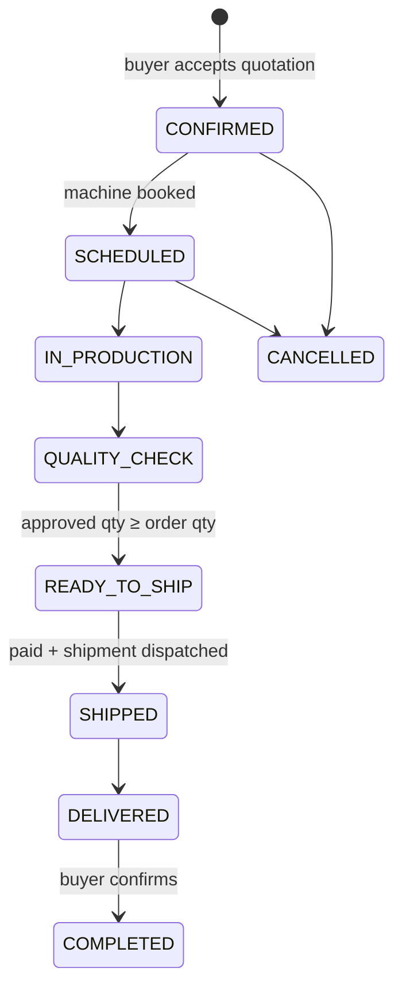
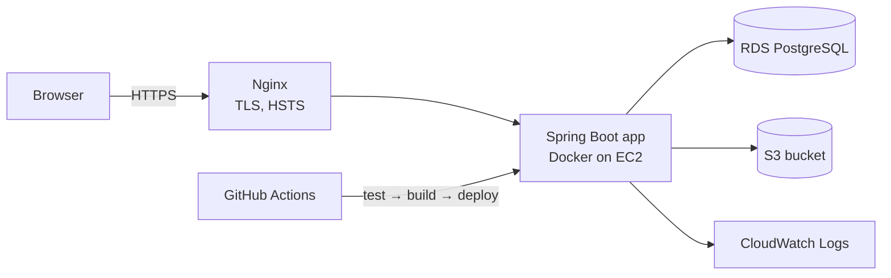

# ForgeTrace

**B2B manufacturing marketplace with end-to-end batch traceability.**
Buyers post RFQs, verified manufacturers quote, orders are scheduled on real machine capacity,
every batch is quality-inspected, and approved batches get a public **QR product passport**.

> B.Tech IT – Semester 5 Integrated Assignment · [College name] · [Team member names]

---

## Features by role

| Role | What they can do |
|---|---|
| **Buyer** | Post RFQs with specs & drawings · compare quotations · accept → order · pay (sandbox gateway) · track shipment · product passports · disputes · reviews · acknowledge recalls |
| **Manufacturer** | Company profile & verification · machines (incl. CSV import) · weekly availability & maintenance · RFQ inbox (matched by process + material) · quotations · production board · machine booking · batches · shipments · payments received |
| **Quality inspector** | Inspection queue · measurements with automatic tolerance check · approve / reject / hold · history & pass-rate |
| **Admin** | Dashboard with charts · manufacturer verification · users & organizations · orders, RFQs, machines, batches, payments · recalls · disputes · reviews · PDF/CSV reports (background thread) · audit log export · contact requests |
| **Public** | Landing pages · manufacturer directory · contact form · scan a QR → public passport page |

## Order lifecycle


## Tech stack
| Layer | Technology |
|---|---|
| Backend | Java 21, Spring Boot 4.2, Spring MVC, Spring Security 7, Spring Data JPA / Hibernate 7 |
| Frontend | Thymeleaf (server-rendered), Bootstrap 5.3, Bootstrap Icons, Chart.js, vanilla JS |
| Database | PostgreSQL 17, Flyway migrations (V1–V8), JSONB, exclusion constraint for bookings |
| Files | Local disk (dev) / Amazon S3 with SSE (prod) · ZXing QR · Apache PDFBox |
| Testing | JUnit 5 (Jupiter 6), Mockito, AssertJ, Spring MockMvc, Spring Security Test, JaCoCo |
| DevOps | Docker (multi-stage, ARM64), Docker Compose, Nginx + Let's Encrypt, GitHub Actions |
| Cloud | AWS EC2 (Graviton), RDS PostgreSQL, S3, IAM role, CloudWatch Logs & Alarms, SNS |

## Architecture

Layered design: `controller` → `service` (business rules, access checks, transactions) → `repository` (Spring Data) → `entity`.
DTOs + mappers keep entities out of templates; access checks return **404 for other organizations' data** (no information leak).

## Java concepts demonstrated (assignment mapping)
| Concept | Where |
|---|---|
| Inheritance | `CreatedEntity` → `AuditableEntity` → entities; `ForgeTraceException` → `BusinessRuleException` → 8 specific exceptions |
| Abstraction / interfaces | `FileStorageService`, `PaymentGateway`, `ReportExporter`, notification channels |
| Polymorphism | `LocalFileStorageService` vs `S3FileStorageService`; `PdfReportExporter` vs `CsvReportExporter`; in-app vs email channel |
| Encapsulation | Entities with behaviour (`Inspection.addMeasurement`, `OrderStatus.canTransitionTo`), immutable `record` DTOs |
| Generics + Template Method | `AbstractCsvHandler<T>` → `MachineCsvImporter`, `AuditLogCsvExporter`, anonymous handler in `CsvReportExporter` |
| Custom exceptions | 14 classes, mapped to HTTP status by `GlobalExceptionHandler` / `ApiExceptionHandler` |
| Multithreading | Bounded `ThreadPoolExecutor` + `CompletableFuture` fan-out for notifications (after commit) · `@Async` report generation · `ConcurrentHashMap` + `volatile` job status · `@Scheduled` expiry jobs |
| Concurrency safety | Pessimistic lock on quotation accept & payment · idempotency key · PostgreSQL exclusion constraint prevents double-booking a machine |
| File I/O | CSV import (validation per row) and export (CSV-injection safe) · PDF reports · uploads with magic-byte check · QR PNG generation |
| Enums with behaviour | `OrderStatus`, `BatchStatus` state machines; `MeasurementResult.evaluate` |

## Run locally (Windows / PowerShell)
Requirements: Java 21, Docker Desktop.
```powershell
git clone [repo-url]
cd forgetrace
docker compose up -d          # PostgreSQL 17 on localhost:5432
.\mvnw.cmd spring-boot:run    # http://localhost:8080
```
Dev accounts (seeded automatically):

| Role | Email | Password |
|---|---|---|
| Admin | admin@forgetrace.local | Admin@12345 |
| Quality inspector | inspector@forgetrace.local | Inspector@12345 |

Register a buyer and a manufacturer from the sign-up page; approve the manufacturer as admin.
Sandbox payments: card `4111 1111 1111 1111` succeeds, `4000 0000 0000 0002` is declined.

## Tests
```powershell
.\mvnw.cmd test                         # 83 tests (77 unit + 6 integration; needs Docker DB)
start target\site\jacoco\index.html     # coverage report
```
Details: [`docs/testing/test-plan.md`](docs/testing/test-plan.md), [`test-cases.md`](docs/testing/test-cases.md), [`defect-log.md`](docs/testing/defect-log.md).

## Deployment
Push to `main` → GitHub Actions runs tests → builds ARM64 image → deploys to EC2.
Full guide: [`docs/deployment/aws-deployment-guide.md`](docs/deployment/aws-deployment-guide.md) · Costs: [`cost-estimate.md`](docs/deployment/cost-estimate.md)

Live demo: `https://[your-domain]`

## Project structure
```
src/main/java/com/forgetrace/
  config/  controller/{web,buyer,manufacturer,inspector,admin,api}/  dto/  entity/  enums/
  exception/  fileio/  mapper/  notification/  payment/  qr/  report/  repository/
  scheduler/  security/  service/  storage/  util/  validation/
src/main/resources/  db/migration/ (V1–V8)  templates/  static/
src/test/java/       unit + integration tests
deploy/              docker-compose.prod.yml, nginx, EC2 setup, IAM policy
docs/                business, testing, deployment, pitch, report
```

## Business documents
[Business Model Canvas](docs/business/business-model-canvas.md) · [Lean Canvas](docs/business/lean-canvas.md) · [E-commerce model](docs/business/ecommerce-model.md) · [Pitch deck](docs/pitch/pitch-deck.md)

## Team
| Name | Roll no. | Main contribution |
|---|---|---|
| [Name] | [ ] | [ ] |
| [Name] | [ ] | [ ] |